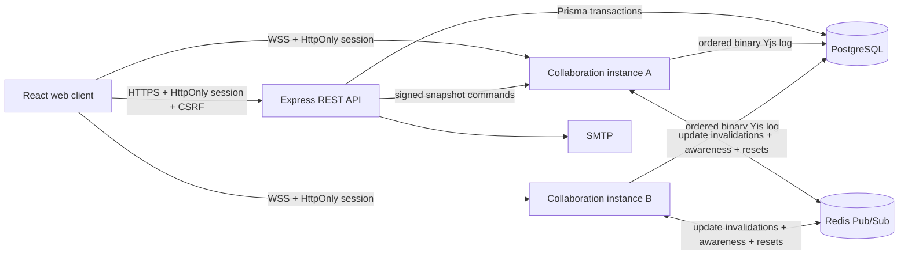

# System architecture

## Service topology

The REST API owns identity and ordinary product metadata. The collaboration service owns long-lived Yjs sync, awareness, document generation, and durable update ingestion. This separation prevents REST workers from carrying WebSocket state and allows independent horizontal scaling.

## Trust boundaries

1. REST authenticates an opaque cookie against a hashed, expiring `Session` record.
2. State-changing REST requests require a signed double-submit CSRF value.
3. WebSocket upgrades validate `Origin`, session, workspace membership, page permission, and document generation.
4. Permission is refreshed before every incoming document mutation. Viewer updates are rejected before Yjs application or persistence.
5. Awareness identity and cursor color are server-derived; client-supplied identity is discarded.
6. Internal snapshot operations are timestamped and HMAC-signed between API and collaboration services.

## Durable multi-instance Yjs strategy

Each page has one `DocumentState` row containing a compacted Yjs update, state vector, generation, and compaction watermark. Every accepted update is hashed for idempotency and appended to `DocumentUpdate` in PostgreSQL before local or cross-instance broadcast.

Redis messages intentionally carry only coordination data: page ID, generation, durable update ID, source instance, or an ephemeral awareness payload. A receiving instance never treats Pub/Sub as document truth. It queries PostgreSQL for every ordered update after its contiguous watermark and applies them in ID order. If compaction moved beyond that watermark, it first applies the compacted state and then replays newer updates. A periodic reconciliation loop performs the same check, recovering dropped or reordered Redis notifications.

Awareness is never persisted. Sanitized awareness updates fan out through Redis; clean disconnects publish null-state removals, while stale remote states expire after heartbeat inactivity.

Snapshot restore writes a pre-restore snapshot, replaces the active Yjs baseline, increments the generation, retains prior history, records activity, and publishes a reset event. Every instance closes clients on the old generation; reconnecting clients load and converge on the restored generation.

## Compaction and shutdown

Compaction writes state and its watermark transactionally with a conditional update. Concurrent compactors are harmless because only a newer watermark can advance the row. Superseded log rows are deleted only after the compacted baseline is committed.

`SIGTERM` stops new work, closes WebSockets with retryable codes, waits for room queues, compacts active rooms, closes Redis, and disconnects Prisma. `/health/live` reports process liveness; `/health/ready` verifies required dependencies and draining state.
