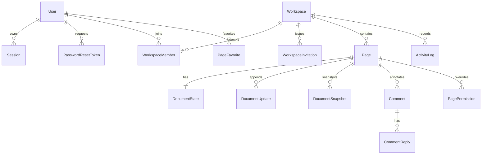

# Data model

The executable schema lives in `packages/database/prisma/schema.prisma`. Binary Yjs fields use PostgreSQL `bytea` through Prisma `Bytes`.

## Permission model

- Workspace role: `OWNER`, `ADMIN`, or `MEMBER`.
- Member content permission: `EDITOR`, `COMMENTER`, or `VIEWER`.
- Owners and admins can administer the workspace and edit content.
- A page permission override can reduce or elevate a member's content permission without changing workspace administration rights.
- Effective permissions are calculated in shared code and repeated authorization checks run at REST controllers and WebSocket update ingress.

## Deletion and retention

Pages are soft-deleted with `deletedAt` and can be restored. Workspace deletion is a deliberate hard-delete operation that cascades page content and related metadata. Sessions and reset tokens cascade with their user. Snapshots and activity records remain immutable for the lifetime of their workspace unless a configured retention job removes them.
