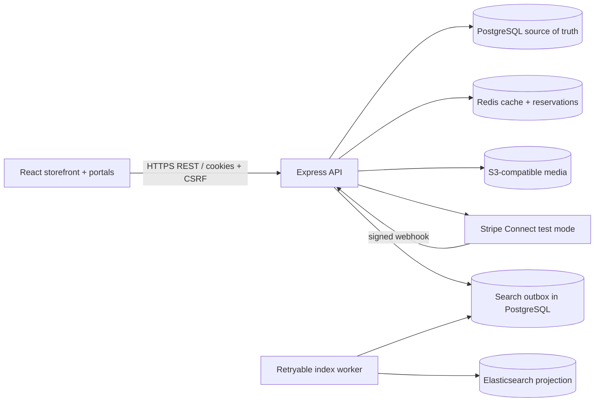

# AUREVA architecture

The parent `Order` owns payment and customer totals. Each participating seller receives an independently fulfillable `VendorOrder`. Inventory is reserved transactionally before provider payment initiation. PostgreSQL stores the authoritative catalog and order state; Elasticsearch can be rebuilt from it and is never trusted for checkout pricing.

## Route map

- Storefront: `/`, `/products`, `/category/:slug`, `/product/:slug`, `/search`, `/deals`, `/new`, `/collections`, `/vendors`, `/vendor/:slug`, `/about`, `/contact`, `/faq`, policy routes.
- Customer: `/login`, `/register`, `/forgot-password`, `/reset-password`, `/account`, `/account/addresses`, `/wishlist`, `/cart`, `/checkout`, `/orders`, `/orders/:id`, `/notifications`, `/support`.
- Vendor: `/vendor-portal/onboarding`, `/vendor-portal`, `/vendor-portal/products`, `/vendor-portal/products/new`, `/vendor-portal/orders`, `/vendor-portal/analytics`, `/vendor-portal/payouts`, `/vendor-portal/settings`.
- Admin: `/admin`, `/admin/vendors`, `/admin/products`, `/admin/orders`, `/admin/categories`, `/admin/refunds`, `/admin/payouts`, `/admin/support`, `/admin/audit`.

## Security boundaries

Short-lived access JWTs and rotated refresh tokens are HttpOnly cookies. Mutations require a double-submit CSRF token. Every vendor query constrains resources by authenticated vendor ID. Provider webhooks use the raw body and signature verification before idempotent event persistence.
