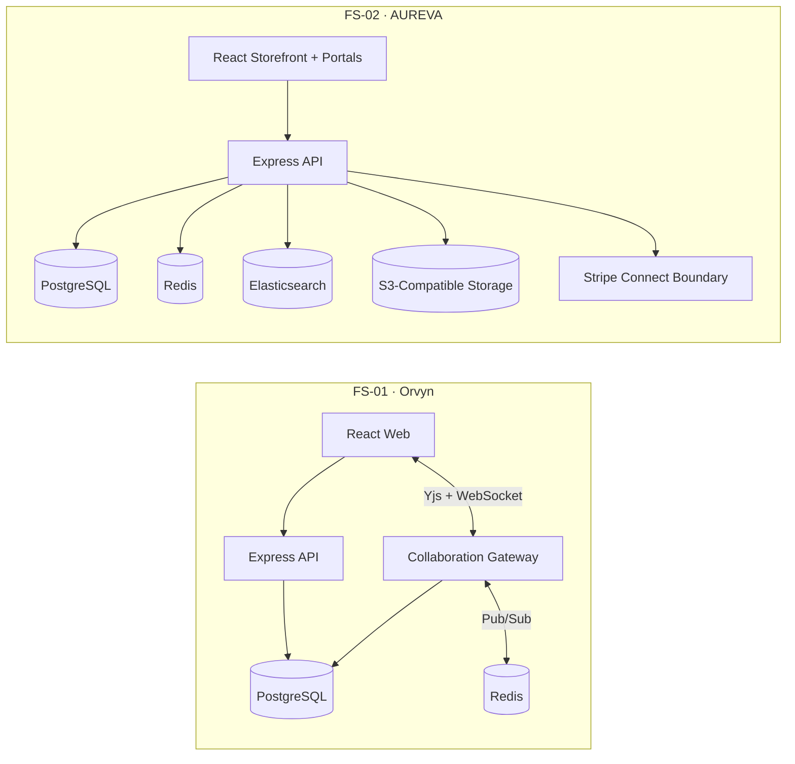
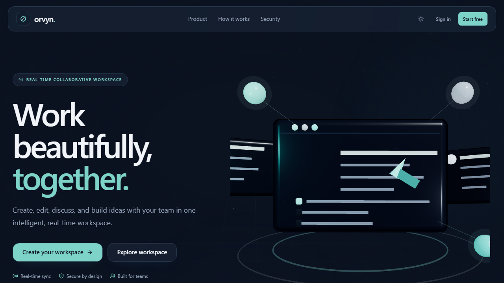
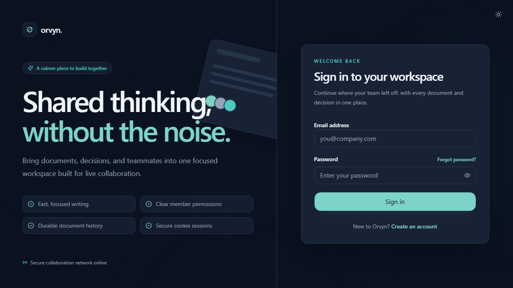
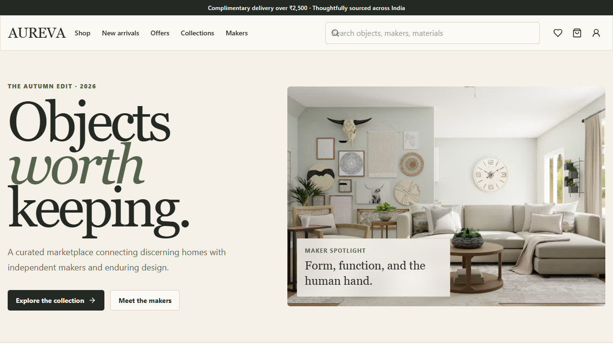
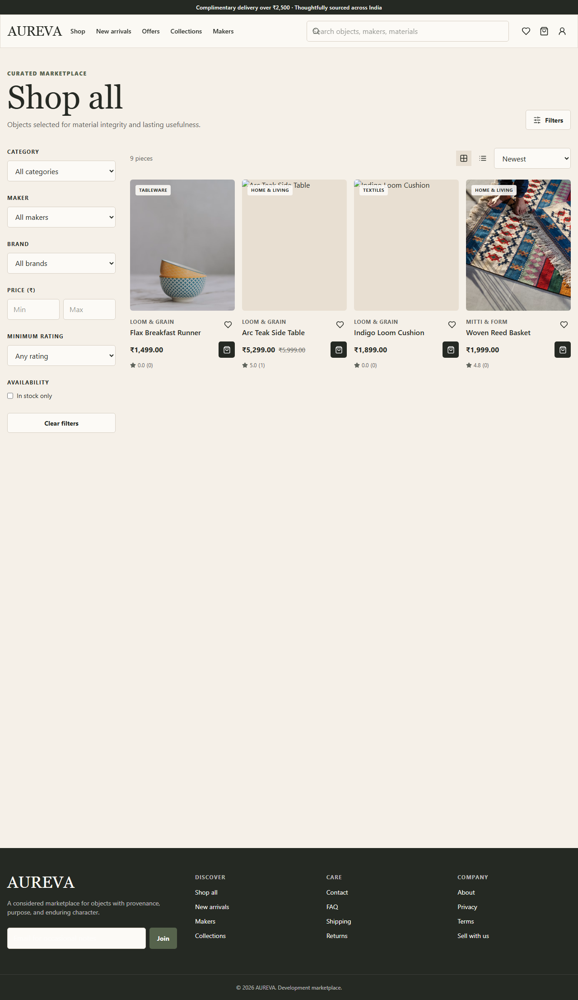

# Full-Stack Engineering Project Submission

This public repository contains both allotted production-minded full-stack projects as independent, runnable monorepos:

| Project | Product | Primary stack | Local URL |
| --- | --- | --- | --- |
| [`FS-01`](FS-01/README.md) | **Orvyn** — real-time collaborative workspace | React, Express, PostgreSQL, Prisma, Yjs, TipTap, WebSockets, Redis | `http://localhost:5173` |
| [`FS-02`](FS-02/README.md) | **AUREVA** — multi-vendor marketplace | React, Express, PostgreSQL, Prisma, Redis, Elasticsearch, S3, Stripe | `http://localhost:5174` |

Both projects include real persistence, secure authentication, role-based authorization, production Docker images, database migrations, seed data, automated tests, responsive interfaces, health checks, and detailed technical documentation. Neither project is a static mockup.

## Submission Checklist

| Project | Working demo | Technical package | Presentation | Reflection |
| --- | --- | --- | --- | --- |
| Orvyn | [Screen recording](FS-01/docs/demos/orvyn-working-demo.webm) | [Deliverables index](FS-01/docs/submission-deliverables.md) | [10-minute outline](FS-01/docs/presentation-outline.md) | [Individual reflection](FS-01/docs/individual-reflection.md) |
| AUREVA | [Screen recording](FS-02/docs/demos/aureva-working-demo.webm) | [Deliverables index](FS-02/docs/submission-deliverables.md) | [10-minute outline](FS-02/docs/presentation.md) | [Individual reflection](FS-02/docs/individual-reflection.md) |

## Repository Structure

```text
.
├── FS-01/                  # Orvyn collaborative workspace
│   ├── apps/               # Web, REST API, collaboration gateway
│   ├── packages/           # Shared contracts and Prisma database package
│   ├── tests/              # Browser and load tests
│   ├── docs/               # Architecture, protocol, deployment, reports
│   └── compose.yaml        # Web + API + WebSocket + PostgreSQL + Redis
├── FS-02/                  # AUREVA marketplace
│   ├── apps/               # Storefront, customer/vendor/admin UI, REST API
│   ├── packages/           # Shared schemas and Prisma database package
│   ├── tests/              # Playwright journeys
│   ├── docs/               # Architecture, API, security, deployment, reports
│   └── compose.yaml        # Web + API + PostgreSQL + Redis + ES + S3 mock
└── README.md               # Submission overview
```

## Architecture Overview



Detailed diagrams and data models are available in [`FS-01/docs`](FS-01/docs) and [`FS-02/docs`](FS-02/docs).

## FS-01 — Orvyn

Orvyn is a secure collaborative knowledge workspace inspired by modern document tools.

### Implemented Features

- Cookie-based registration, login, logout, password reset, session expiry, CSRF protection, and rate limiting.
- Workspace creation, membership, invitations, owner/admin/member roles, nested pages, favorites, search, restore, and ordering.
- TipTap rich-text editing backed by Yjs binary updates—not HTML autosave as the source of truth.
- Authenticated per-page WebSocket rooms, reconnect synchronization, durable updates, compaction, and Redis multi-instance propagation.
- Awareness presence, remote selections/cursors, stale-client cleanup, anchored comments/replies, and permission-aware read-only mode.
- Revision snapshots, previews, safe restore, activity auditing, responsive desktop/mobile shells, and light/dark themes.

### Screenshots





## FS-02 — AUREVA

AUREVA is a complete multi-vendor commerce platform with customer, seller, and administrator experiences.

### Implemented Features

- Secure customer/vendor/admin authentication with HttpOnly JWT cookies, refresh rotation, CSRF, RBAC, ownership checks, and audit logs.
- Public discovery, categories, vendor storefronts, product variants, inventory, media uploads, wishlist, persistent cart, and responsive checkout.
- Transactional stock reservations, multi-vendor order splitting, server-derived totals, coupon rules, commissions, fulfillment, returns, refunds, and invoices.
- Vendor onboarding, product/inventory/order management, analytics, coupons, commissions, payouts, reviews, support, and store settings.
- Admin customer/vendor/product/category/order/refund/dispute/review/support/payout/settings management with database-derived analytics.
- Stripe webhook verification/idempotency, S3-compatible presigned upload verification, Redis caching, and retryable Elasticsearch outbox indexing.

### Screenshots





## Run Locally

### Prerequisites

- Node.js 22+
- npm 10+
- Docker Desktop with Compose v2

### Orvyn (`FS-01`)

```powershell
cd FS-01
Copy-Item .env.example .env
npm ci
npm run db:generate
docker compose up -d --build
npm run db:seed
```

Open `http://localhost:5173`. API and collaboration readiness endpoints are documented in [`FS-01/README.md`](FS-01/README.md).

### AUREVA (`FS-02`)

```powershell
cd FS-02
Copy-Item .env.example .env
npm ci
npm run db:generate
docker compose up -d --build
npm run db:seed
```

Open `http://localhost:5174`; the API is available at `http://localhost:4100`. Local object storage uses S3Mock only for development; production requires real S3-compatible storage.

The projects use different host ports, so both Compose stacks can run simultaneously.

## Verification Summary

Latest local verification on **2026-11-20**:

| Project | Verification |
| --- | --- |
| Orvyn | 44 unit/integration tests passed across API, collaboration, web, and shared packages; all five containers reported healthy |
| AUREVA | 39 unit/integration tests and 5 Playwright journeys passed; full Docker stack, real S3-compatible upload round trip, and Elasticsearch-backed search verified |
| AUREVA load sample | 329/329 requests succeeded, 32.49 req/s, p50 9.39 ms, p95 44.26 ms, p99 64.35 ms on a local four-client/10-second run |

These are reproducible local development results, not production capacity claims. Exact test procedures and limitations are recorded in each project's testing and performance documentation.

## Security and Configuration

- Real `.env` files, generated clients, dependencies, build output, and test artifacts are excluded from Git.
- Demo accounts exist only in development seed data.
- No production credentials are committed or embedded in frontend bundles.
- External payment, email, object-storage, carrier, tax, and hosting credentials must be supplied through deployment secrets.
- Review [`FS-01/docs/security.md`](FS-01/docs/security.md) and [`FS-02/docs/security.md`](FS-02/docs/security.md) before production rollout.

## Documentation Index

- Orvyn: [Deliverables](FS-01/docs/submission-deliverables.md) · [README](FS-01/README.md) · [Architecture](FS-01/docs/architecture.md) · [API](FS-01/docs/api-reference.md) · [WebSocket protocol](FS-01/docs/websocket-protocol.md) · [Deployment](FS-01/docs/deployment.md) · [Testing](FS-01/docs/testing.md)
- AUREVA: [Deliverables](FS-02/docs/submission-deliverables.md) · [README](FS-02/README.md) · [Architecture](FS-02/docs/architecture.md) · [ER diagram](FS-02/docs/er-diagram.md) · [API](FS-02/docs/api.md) · [Deployment](FS-02/docs/deployment.md) · [Testing](FS-02/docs/testing.md)
